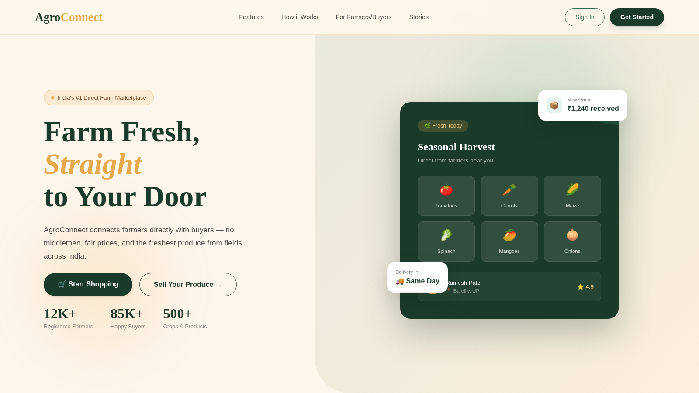
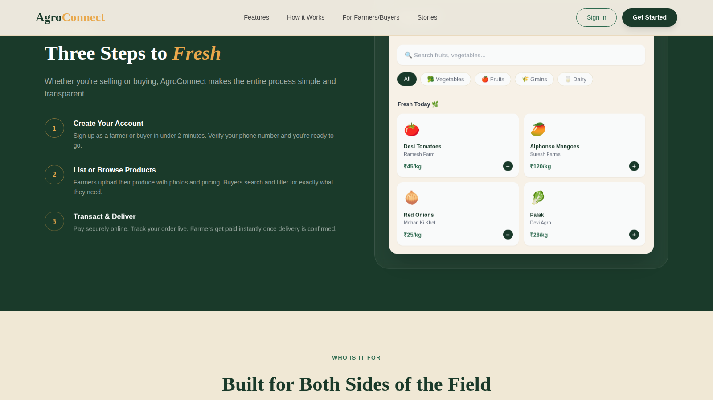
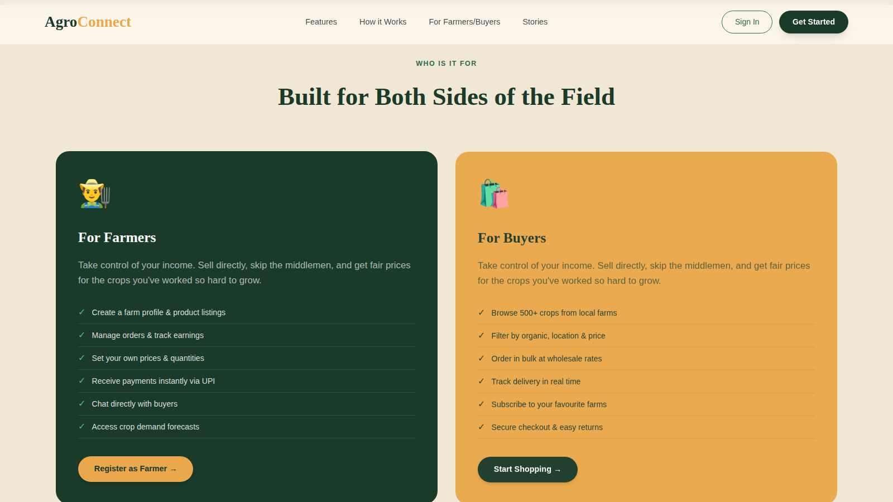

# Farmer Marketplace

2-sided agri marketplace connecting farmers and buyers with escrow-based payments.
**Live:** https://farmer-market-place-mu.vercel.app

## Features
- Two roles: Farmers (list products, manage inventory) and Buyers (browse, order)
- Escrow flow: order creation, payment verification, shipping, delivery confirmation, refunds
- Group buying module
- Live mandi price data via data.gov.in API
- Auto-refund processing with Node.js Cron
- Supabase Auth + PostgreSQL Row Level Security

## Tech Stack
React.js, Tailwind CSS, Node.js, Express.js, Supabase, PostgreSQL

## My Contribution
Backend and database:
- Escrow REST endpoints — `backend/routes/orderRoutes.js` + `backend/controllers/escrowController.js`: `POST /create-order`, `/verify-payment`, `/update-status`, `/ship-order`, `/confirm-delivery`, `/refund`
- Escrow service logic — `backend/services/escrowService.js`: payment verification, order status transitions, `refundOrder`
- Auto-refund cron — `backend/server.js` + `backend/services/escrowService.js`: `node-cron` schedule (`0 * * * *`, hourly) that auto-refunds expired/unconfirmed orders
- Express API — `Server/index.js`: order status updates (`POST /api/orders/update-status`), farmer analytics (`GET /api/farmer/:id/analytics`)
- Database + security — `supabase_backend/schema.sql`: tables plus 10 Row Level Security policies

## Setup
1. `git clone` the repo and run `npm install`
2. Copy `.env.example` to `.env` and add your own keys
3. `npm run dev`

## Screenshots

